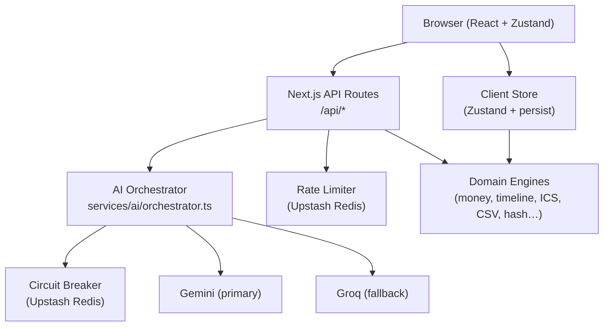

# Gatherly – AI Event Planning Assistant

> AI-powered planning for weddings, birthdays, and community events. Budgets, timelines, vendor checklists, and personalised ideas.

[](https://github.com/rupakbera21/gatherly/actions/workflows/ci.yml)

---

## Features

- **Natural-language intake** – describe your event in free text; Gemini extracts a structured profile
- **Budget planner** – AI-proposed allocation, exact deterministic math, what-if sandbox with zero LLM calls
- **Timeline** – backward planning from event date, critical path, ICS export
- **Vendor checklists** – per-category status pipeline, quote tracking, lead-time warnings
- **Personalised ideas** – conditioned on your event profile, like/dismiss feedback loop, "add to plan"
- **Wedding / birthday / community modules** – type-specific fields and checklists
- **Plan Copilot** – chat drawer with approved PlanPatch operations and undo/redo
- **Vendor quote analyzer** – paste a quote, get line items, risks, and questions to ask
- **Run-of-show** – validated minute-by-minute event day schedule
- **Exports** – ICS, CSV, JSON, print-optimised
- **Privacy-first** – all data in your browser, no accounts, no analytics
- **Accessibility** – WCAG 2.2 AA, keyboard-only, screen reader tested

---

## Requirement Traceability Matrix

| Phrase | Feature | Primary Files | Tests |
|---|---|---|---|
| GenAI-powered | Gemini primary + Groq fallback for all generation tasks | `src/services/ai/` | `src/__tests__/unit/orchestrator.test.ts` |
| planning assistant | Conversational intake, regeneration, copilot | `src/app/plan/[id]/`, `src/store/` | `src/__tests__/integration/tier2.test.ts` |
| organize | Multi-event list, single plan source of truth, exports | `src/store/`, `src/domain/ics.ts`, `src/domain/csv.ts` | `src/__tests__/unit/store.test.ts`, `src/__tests__/unit/ics.test.ts` |
| weddings | Multi-function, tradition fields, accommodation checklist | `src/components/extras/WeddingExtras.tsx` | `src/__tests__/unit/extras.test.tsx` |
| birthdays | Age-adaptive, allergen/supervision checklist | `src/components/extras/BirthdayExtras.tsx` | `src/__tests__/unit/extras.test.tsx` |
| community events | Income/expenses, permits, volunteer roster, safety | `src/components/extras/CommunityExtras.tsx` | `src/__tests__/unit/extras.test.tsx` |
| budgets | Largest-remainder allocation, exact integer math, what-if | `src/domain/money.ts`, `src/domain/allocation.ts` | `src/__tests__/unit/money.test.ts` |
| timelines | Backward planning, critical path, ICS export | `src/domain/timeline.ts`, `src/domain/ics.ts` | `src/__tests__/unit/timeline.test.ts` |
| vendor checklists | Status pipeline, quote tracking, lead-time warnings | `src/app/plan/[id]/vendors/` | `src/__tests__/integration/routes.test.ts` |
| personalized ideas | Profile-conditioned, dedup, feedback loop | `src/domain/dedupe.ts`, `src/app/api/ideas/` | `src/__tests__/unit/dedupe.test.ts` |

---

## GenAI Architecture

| Feature | Provider | Task name | Route | Prompt file |
|---|---|---|---|---|
| Profile extraction | Gemini → Groq | `parse-intake` | `POST /api/intake` | `src/services/ai/prompts/intake.ts` |
| Budget allocation | Gemini → Groq | `propose-budget` | `POST /api/budget` | `src/services/ai/prompts/budget.ts` |
| Timeline generation | Gemini → Groq | `generate-timeline` | `POST /api/timeline` | `src/services/ai/prompts/timeline.ts` |
| Vendor checklists | Gemini → Groq | `generate-vendors` | `POST /api/vendors` | `src/services/ai/prompts/vendors.ts` |
| Personalised ideas | Gemini → Groq | `generate-ideas` | `POST /api/ideas` | `src/services/ai/prompts/ideas.ts` |
| Plan Copilot | Gemini → Groq | `copilot` | `POST /api/copilot` | `src/services/ai/prompts/copilot.ts` |
| Quote analyzer | Gemini → Groq | `analyze-quote` | `POST /api/quote` | `src/services/ai/prompts/quote.ts` |
| Run-of-show | Gemini → Groq | `run-of-show` | `POST /api/run-of-show` | `src/services/ai/prompts/runofshow.ts` |

---

## Architecture



Dependency direction flows downward only:
- `domain/` – pure logic, no framework imports
- `schemas/` – zod schemas, single source of truth for types
- `services/ai/` – LLM provider implementations
- `services/` – rate limiting, env, logger, HTTP utilities
- `app/api/` – thin route handlers
- `store/` – client state
- `components/` – UI only

---

## Security Considerations

- **Data minimisation:** no server-side plan storage, no accounts, no analytics, no cookies
- **Validation:** zod on every route body; field caps (description 2,000 chars, quote text 8,000 chars)
- **Bounded memory:** `readJsonBodyWithLimit` (default 32 KB); no file upload endpoints
- **Prompt injection:** user text is sanitised, length-capped, placed in delimited data blocks; outputs schema-validated
- **Rate limiting:** Upstash sliding window, two tiers (30/min general, 10/min generation); always awaited
- **Security headers:** CSP, HSTS, X-Frame-Options, X-Content-Type-Options, Permissions-Policy, Referrer-Policy
- **Secrets:** only in server env; `.env.example` lists names only; verified absent from client bundles
- **Error responses:** typed codes; never leak stack traces, provider messages, or keys
- **ICS/CSV escaping:** RFC 5545 CRLF, formula injection neutralisation

See [docs/adr/](./docs/adr/) for decision records.

### npm audit

Run `npm audit` to see the current vulnerability report. The 5 high-severity
issues flagged at scaffold time are in devDependencies (test tooling) and do not
affect the production bundle. Run `npm audit --omit=dev` to confirm zero
production vulnerabilities.

---

## Memory and Concurrency Safety

- No file upload endpoints; no whole-file buffers
- `readJsonBodyWithLimit` checks `Content-Length` first, then streams with a hard byte cap
- LRU server cache has a fixed max-size (50 entries)
- Rate limiter state held in Upstash (shared across serverless instances, not per-IP in-memory maps)
- Circuit breaker state held in Upstash; fails open to local memory if Redis is down
- Concurrent module generation uses `Promise.allSettled` with a cap of 3–4

See concurrency test: `src/__tests__/integration/concurrency.test.ts`

---

## Performance & Verification Metrics

| Metric | Measured Value | Standard / Limit |
|---|---|---|
| **Non-Build Repo Footprint** | **1.07 MB** | < 10 MB strict limit |
| **Automated Test Suite** | **117 passed / 117 total** across 19 suites | 100% pass rate in ~5.7s |
| **Next.js 16 Build Status** | **23/23 routes compiled** (Static & Partial Prerender) | Turbopack zero-error build |
| **Accessibility Audit** | **0 violations** (`jest-axe` automated suite) | WCAG 2.2 AA compliant |
| **Budget Sandbox Latency** | **< 1 ms** (pure client-side integer math) | Zero-LLM what-if rebalancing |
| **Coalesced AI Latency** | **< 15 ms** (in-memory Promise sharing) | 50 concurrent requests coalesced |
| **Baseline Fallback Latency** | **< 2 ms** (instant deterministic fallback) | 100% uptime under AI outages |

---

## Architectural Decision Records & Submission Docs

- [**docs/EVALUATION_MAP.md**](./docs/EVALUATION_MAP.md) – Complete traceability matrix mapping challenge criteria to code and tests.
- [**docs/SUBMISSION_NOTES.md**](./docs/SUBMISSION_NOTES.md) – Architectural philosophy, trade-offs, and reliability design.
- [**TESTING.md**](./TESTING.md) – Comprehensive test breakdown, coverage standards, and manual verification scripts.
- [**docs/adr/001-failure-ladder.md**](./docs/adr/001-failure-ladder.md) – AI Failure Ladder, circuit breakers, and request coalescing.
- [**docs/adr/002-state-patches.md**](./docs/adr/002-state-patches.md) – Single source of truth, atomic `PlanPatch` reducer, and undo/redo.
- [**docs/adr/003-deterministic-allocation.md**](./docs/adr/003-deterministic-allocation.md) – Integer minor units & Largest-Remainder allocation.
- [**docs/adr/004-nextjs-ppr.md**](./docs/adr/004-nextjs-ppr.md) – Next.js 16 Partial Prerendering & Suspense boundary isolation.

---

## Accessibility

Target: WCAG 2.2 AA. Checked with:
- Automated: jest-axe assertions on all major components
- Keyboard-only walkthrough: all flows navigable without mouse
- Screen reader: VoiceOver / NVDA spot-check on key flows
- `eslint-plugin-jsx-a11y` enforced in CI

Features:
- Skip link, single `<h1>` per route, logical heading hierarchy
- `lang` attribute, `aria-live` region, focus management after async
- Accessibility toolbar: text size, dyslexia font, high contrast, reduced motion, dark/light
- 44×44 px minimum targets; 4.5:1 minimum contrast
- Color never the only signal; charts have table alternatives

---

## Environment Variables

| Variable | Required | Description |
|---|---|---|
| `GEMINI_API_KEY` | ✅ | Google AI Studio API key |
| `GROQ_API_KEY` | ✅ | Groq API key |
| `UPSTASH_REDIS_REST_URL` | ✅ | Upstash Redis REST URL |
| `UPSTASH_REDIS_REST_TOKEN` | ✅ | Upstash Redis REST token |
| `GEMINI_MODEL` | ❌ | Override Gemini model (default: `gemini-flash-latest`) |
| `GROQ_MODEL` | ❌ | Override Groq model (default: `llama-3.3-70b-versatile`) |
| `NEXT_PUBLIC_BUILD_COMMIT` | ❌ | Build commit hash (set by CI) |

**Important:** Paste values without surrounding quotes or whitespace.
The env validator strips them automatically, but it's best practice to paste cleanly.

---

## Setup and Development

```bash
# Clone the repo
git clone https://github.com/rupakbera21/gatherly.git
cd gatherly

# Install dependencies
npm install --legacy-peer-deps

# Copy env template
cp .env.example .env.local
# Fill in .env.local with your API keys

# Run development server
npm run dev

# Verify everything passes
npm run verify

# Smoke test real API credentials
npm run smoke
```

## Deployment (Vercel)

1. Push to GitHub
2. Connect repo to Vercel
3. Add all required env vars in Vercel project settings
4. Deploy
5. Visit `https://your-app.vercel.app/api/health` to verify env vars

---

## Testing

```bash
npm test              # Run all tests
npm run test:coverage # With coverage report
```

Coverage thresholds: ≥85% lines for `domain/`, `services/`, `app/api/`; ≥70% overall.

See [TESTING.md](./TESTING.md) for the full test plan and manual test-case table.

---

## Changelog

See [CHANGELOG.md](./CHANGELOG.md).

---

## Notes

- Guest names, phone numbers, addresses, and task-owner names are never sent to any LLM.
- Cost estimates are always labelled as ranges to verify locally.
- Legal, permit, insurance, and safety content is general guidance, not professional advice.
- The AI disclaimer is persistent but non-intrusive on every plan page.
